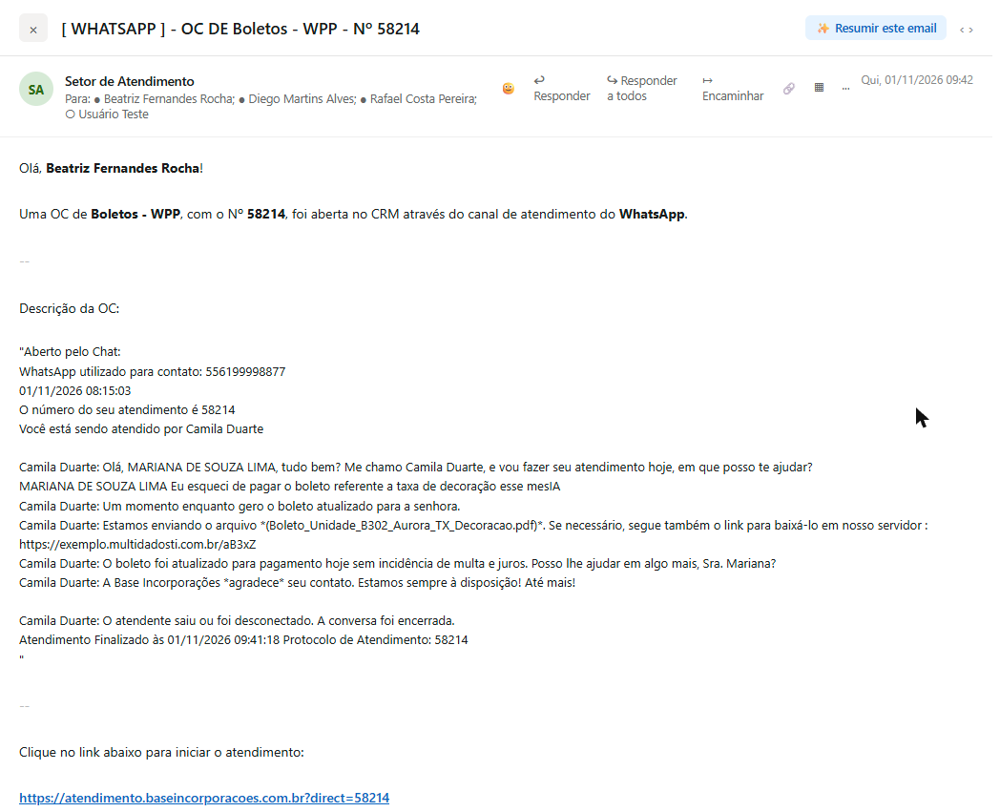
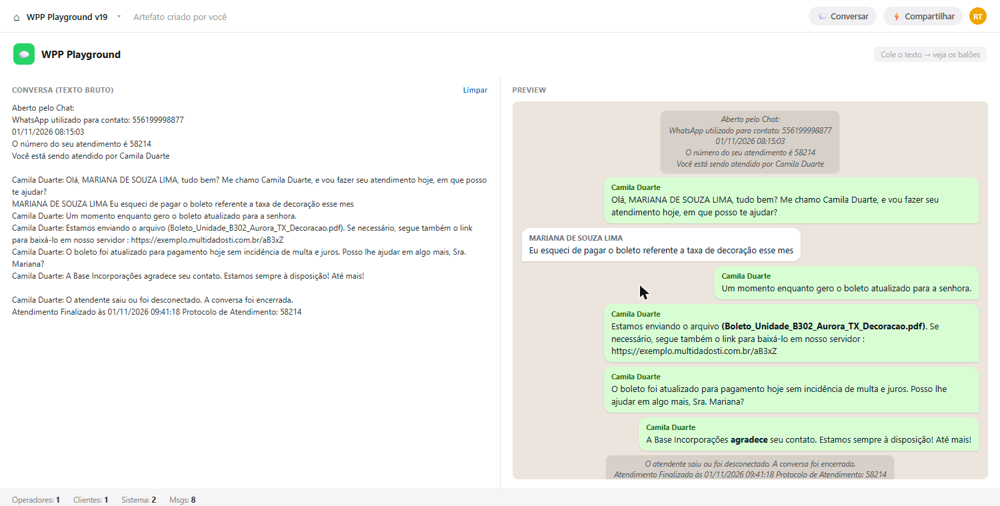

# wpp-chat-render

Skill para [Claude Code](https://claude.com/claude-code) que converte texto bruto de conversa do
WhatsApp (copiado e colado de um chat de suporte, exportação do WhatsApp, ou log de chatbot) em
uma interface visual com balões **exatamente como no WhatsApp**: operadores à direita em verde,
clientes à esquerda em cinza/branco, mensagens de sistema centralizadas em itálico.

| Notificação por e-mail (OC gerada automaticamente) | WPP Playground (pré-visualização em tempo real) |
|---|---|
|  |  |

*Nomes, telefone, protocolo e link nas imagens acima são fictícios — recriados a partir de um
caso real para preservar a privacidade do cliente.*

## O que ela faz

- **Detecta quem fala** em três formatos de entrada diferentes (exportação oficial do WhatsApp
  com timestamp, transcrição de chat de suporte, log de chatbot/automação), inclusive quando eles
  aparecem misturados ou com variações.
- **Classifica cada fala** em operador humano (verde, direita), `CHATBOT` (verde com nome em
  azul-petróleo, direita), cliente (branco/cinza, esquerda) ou mensagem de sistema (centralizada,
  cinza, itálico — transferências, encerramentos, preâmbulo de abertura do chat etc.).
- **Remove artefatos de transcrição por IA**: sistemas de transcrição automática costumam colar
  `IA` em nomes e palavras (`retornoIA`, `GUIMARAESIA`, `mp4IA`, `1IA`). A skill reconhece os
  padrões e limpa o texto das mensagens sem nunca tocar no nome dos participantes.
- **Normaliza nomes**: quando o mesmo participante aparece com nome curto e longo na mesma
  conversa (`RENAN VARGAS` vs `RENAN VARGAS GUIMARAES`), usa sempre a versão mais longa. Também
  deduplica nome de operador repetido na mesma linha antes do `:` (`Dionilia Dionilia Silva:` →
  `Dionilia Silva:`).
- **Normaliza o texto bruto antes de separar falas**: remove recuo inicial de linha, injeta
  quebras de linha quando tudo veio colado numa única linha, e recompõe frases de sistema que
  ficaram coladas à fala anterior.
- **Aplica formatação do WhatsApp** (`*negrito*`, `_itálico_`, `~riscado~`, `` `código` `` e
  blocos ` ```código``` `) com escape de HTML antes, na ordem correta, cuidando para não quebrar
  underscores de nomes de arquivo (`2026_09_02_11_19_32_427.mp4`).
- **Gera HTML standalone**, sem dependências externas (exceto jsPDF se o PDF for pedido), pronto
  para abrir no navegador ou salvar como arquivo.
- **Gera PDF** opcional, com um botão "Baixar PDF" que usa jsPDF (via CDN) para desenhar os
  mesmos balões em um PDF A4, com paginação automática.
- **Gera tag `<iframe>`** pronta para embutir a conversa em um e-mail, com `scrolling="no"`,
  altura sugerida e sem o botão de PDF.

## Como usar

No Claude Code, cole o texto da conversa e peça para visualizar, formatar, exportar, embutir em
e-mail, ou gerar PDF da conversa. A skill é acionada automaticamente quando a intenção bate com
um desses pedidos. Resultado padrão: um [Artifact](https://www.anthropic.com/) HTML pronto para
visualização imediata no navegador.

Comandos relacionados disponíveis neste workspace:
- `wpp-html` — gera o Artifact HTML (balões estilo WhatsApp)
- `wpp-pdf` — gera o HTML já com o botão de download de PDF ativo
- `wpp-iframe` — gera o HTML pronto para embutir em e-mail via iframe
- `wpp-excel` — exporta a conversa como planilha `.xlsx` (uma linha por mensagem)
- `wpp-help` — explica o que a skill faz e quais comandos existem

## Formatos de entrada reconhecidos

**1. Exportação do WhatsApp** (com data/hora):
```
12/03/2024, 14:32 - João Silva: Olá, boa tarde!
12/03/2024, 14:33 - CLIENTE: Boa tarde, preciso de ajuda
```

**2. Transcrição de chat de suporte** (sem timestamp, nome em ALL CAPS identifica o cliente):
```
João Silva: Olá, boa tarde!
CLIENTE RENAN VARGAS: Boa tarde, preciso de ajuda
Operador João Silva transferiu o atendimento para Maria.
```

**3. Chatbot/automação** (prefixos ALL CAPS com dois-pontos, sem operador humano):
```
CHATBOT: Olá, seja bem-vindo(a) ao canal de atendimento da *Base Incorporações!*
CLIENTE: Falar com o SAC
CHATBOT: Para qual área deseja atendimento?
CLIENTE: Assistência Técnica
```

A skill lida com os três formatos, inclusive quando aparecem misturados, com preâmbulo de
abertura de chat, ou com todo o texto colado numa única linha sem quebras.

## Exemplos

Os arquivos HTML completos usados para gerar os prints acima estão em [`examples/`](examples):

- [`examples/01-atendimento-humano.html`](examples/01-atendimento-humano.html) — atendimento com
  transferência entre operadores e encerramento.
- [`examples/02-chatbot.html`](examples/02-chatbot.html) — fluxo de chatbot com preâmbulo de
  "Ocorrência aberta pelo Chatbot", transferência de bate-papo e atendimento humano na sequência.

Basta abrir qualquer um deles direto no navegador.

## Estrutura do projeto

```
SKILL.md       # definição completa da skill: regras de identificação, limpeza de IA,
               # normalização, CSS dos balões, lógica de geração de PDF e procedimento
examples/      # conversas de exemplo já renderizadas em HTML
docs/          # screenshots usados neste README
evals/         # casos de avaliação (conversa básica, artefato de IA, iframe de e-mail)
```

## Avaliações (`evals/`)

A skill inclui três casos de avaliação usados para medir a qualidade da renderização:

- **`conversa-basica`** — conversa simples de atendimento humano com transferência de operador.
- **`artefato-ia`** — conversa com artefatos de transcrição por IA (`IA` grudado em nomes e
  palavras) que precisam ser removidos sem afetar os nomes dos participantes.
- **`iframe-email`** — pedido de geração de tag `<iframe>` pronta para embutir em e-mail.

Cada caso tem um `prompt.md` (o pedido do usuário), um `case.yaml` (configuração do teste) e um
grader em `graders/01-expected-output.md` descrevendo o resultado esperado.

## Licença

Uso interno.
